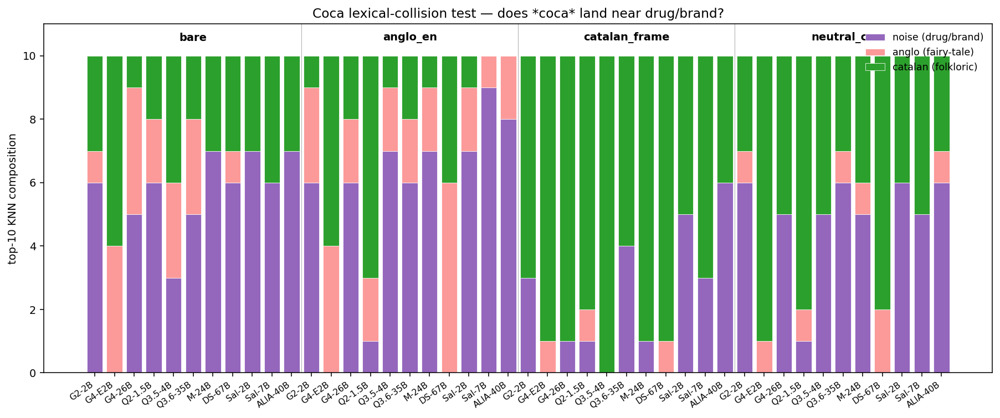

# La coca no és cocaïna (Coca Is Not Cocaine)

<p align="center">
  
  &nbsp;&nbsp;
  
  <br/>
  <sub><em>Esquerra: coca de Sant Joan amb fruita confitada</em>
  (<a href="https://commons.wikimedia.org/wiki/File:Coca_de_San_Juan_(1)_con_frutas_confitadas.jpg">El Mono Español</a>,
  CC BY-SA 4.0).
  &nbsp;·&nbsp;
  <em>Dreta: coca d'espencat (coca de recapte)</em>
  (<a href="https://commons.wikimedia.org/wiki/File:Coca_d%27espencat.jpg">Espencat</a>,
  CC BY-SA 3.0).
  Cap de les dues és cocaïna ni Coca-Cola.</sub>
</p>

> ## Resum
>
> Hem provat si els models de llenguatge grans (LLMs) com Qwen, Gemma,
> Mistral, DeepSeek o la família catalana Salamandra / ALIA del
> **Barcelona Supercomputing Center** "entenen" conceptes culturals
> catalans (com *gegant*, *castell*, *coca*, *correfoc*) o si els confonen
> amb les seves traduccions angleses (*giant*, *castle*, *cocaine*,
> *bonfire*). L'experiment crucial ha estat comparar vuit models
> generalistes entrenats sobretot en anglès (Qwen, Gemma, Mistral,
> DeepSeek) contra tres models entrenats explícitament en català pel
> BSC, de fins a 67.000 milions de paràmetres.
>
> El resultat principal és que les **cinc famílies tenen el mateix patró
> de col·lisió cultural** quan no se'ls dona context: tant els models
> generalistes com els de la família Salamandra col·loquen *coca* a prop de
> *cocaine* i *Coca-Cola* en absència de frase portadora, i totes cinc
> recuperen el significat correcte amb context català al prompt. Això
> suggereix que allò que descrivim com a taxonomia F1 / F2 / F3 de
> col·lisions és una **propietat del pipeline d'embeddings contextualitzats**
> (tokenització, mean-pooling, geometria de l'objectiu d'entrenament), no de
> la barreja de dades.
>
> La feina del BSC en obrir una sèrie de models catalans fins a 40B
> paràmetres és el **control causal indispensable** per arribar a aquesta
> lectura: sense la família Salamandra/ALIA no podríem haver distingit la
> hipòtesi "el problema són les dades" de la hipòtesi "el problema és el
> pipeline". La conseqüència pràctica és complementària de qualsevol
> estratègia de preentrenament: cal **subministrar context català al prompt
> en temps d'inferència**, i això funciona igual de bé per a tots els models
> del panell, generalistes o catalans.

---

## Descobriment principal (en una figura)



Lila = coincidències del clúster de soroll (droga / marca / beguda) en els
10 veïns més propers (KNN) de *coca* per `(model, frame)`. El llindar
preregistrat de `n_noise ≥ 2` fora d' `anglo_en` retorna la branca
**fortament recolzada (estructural)** en **deu dels onze models del panell**:
*coca* conviu amb *cocaine*, *Coca-Cola*, *coke* i *soda* en repòs, i només
un frame natiu català fort en rescata la posició.

El mateix gràfic per a *gegant* i *castell* (els altres dos arquetips F1)
es troba a [`docs/findings.md`](docs/findings.md) §5; la trajectòria UMAP
per model i el mapa de calor de generació creuada també hi són.

### Tres sorpreses del panell d'11 models

Les dues noves famílies de propòsit general (Mistral, DeepSeek) i l'anàlisi
més profunda del català han produït tres resultats que el panell original
de 6 models no hauria pogut detectar. Cap d'ells desmenteix el titular;
tots tres precisen el seu significat real.

- **El pitjor del test del títol és un model amb consciència del català,
  no un dominat per l'anglès.** Salamandra 7B col·loca **9 de 10** àncores
  més properes a *coca* en el clúster de soroll sota `anglo_en`
  (`cocaine, Coca-Cola, soda, caffeine, sugar, pepsi, drug,
  coke, beverage`) — més que qualsevol model Qwen, Gemma, Mistral o
  DeepSeek analitzat. ALIA-40B és el segon amb 8 de 10.
  Tots dos models mantenen veïns de soroll residuals (3-6) sota
  `catalan_frame`, on el nivell de propòsit general els redueix a 0-1.
  La barreja d'entrenament en català no dissol la col·lisió lèxica F1;
  si de cas, deixa un residu més persistent un cop el prompt de context
  hi lluita en contra.

- **DeepSeek 67B és una deriva neta de "conte de fades", no una
  col·lisió de soroll.** Sota tres dels quatre frames (`anglo_en`,
  `catalan_frame`, `neutral_ca`), DeepSeek 67B-base col·loca **zero**
  àncores de soroll en els 10 primers de *coca*. Sota `anglo_en`, els seus
  3 primers són *enchanted forest, fairy, princess* — la col·lisió F2
  s'activa totalment, però la F1 no s'activa gens. És l'únic model del
  panell amb aquesta signatura, i és l'evidència empírica més clara que
  la F1 (col·lisió de clúster lèxic) i la F2 (desplaçament narratiu anglo)
  són modes de fallada separables que necessiten diagnòstics diferents.

- **L'escala no garanteix la recuperació pel prompt.** DeepSeek 67B-base
  és també el **model menys responsiu al frame natiu de tot el panell**
  (caiguda mediana bare → catalan_frame = 0,030, comparable als 0,030 de
  Salamandra-7B). Seixanta-set mil milions de paràmetres densos entrenats
  en una barreja amb gran pes de l'anglès produeixen una representació que
  és essencialment indiferent a l'oració portadora en català; afegir
  paràmetres no ha afegit geometria catalana controlada pel prompt.

---

## Models analitzats (11 base / pre-RLHF)

Tres nivells: quatre famílies de propòsit general (Gemma, Qwen, Mistral,
DeepSeek) a escala petita i gran, més un nivell de control amb consciència
del català de tres models del BSC.

**Nivell petit + generació anterior** (4 models, caben en una GPU de 16 GB):

| Model                | ID de HF                 | sweep de capes | millor capa |
| -------------------- | ------------------------ | -------------- | ----------- |
| Gemma 2 2B base      | `google/gemma-2-2b`      | 6, 15, 22      | 22          |
| Gemma 4 E2B base     | `google/gemma-4-E2B`     | 6, 15, 22      | 22          |
| Qwen2 1.5B base      | `Qwen/Qwen2-1.5B`        | 7, 17, 26      | 26          |
| Qwen 3.5 4B base     | `Qwen/Qwen3.5-4B-Base`   | 9, 22, 32      | 32          |

**Nivell gran + generació actual** (4 models, una sola H200 141 GB):

| Model                       | ID de HF                                    | sweep de capes | millor capa |
| --------------------------- | ------------------------------------------- | -------------- | ----------- |
| Gemma 4 26B-A4B base        | `google/gemma-4-26B-A4B`                    | 8, 18, 27      | 27          |
| Mistral Small 24B base      | `mistralai/Mistral-Small-24B-Base-2501`     | 10, 24, 37     | 37          |
| Qwen 3.6 35B-A3B base       | `Qwen/Qwen3.6-35B-A3B`                      | 10, 24, 36     | 36          |
| DeepSeek 67B base (dens)    | `deepseek-ai/deepseek-llm-67b-base`         | 18, 48, 92     | 92          |

**Nivell de control amb consciència del català** (3 models base de la
[família Salamandra del BSC-LT](https://huggingface.co/BSC-LT) —
entrenats intencionadament en un corpus europeu multilingüe que inclou una
part no trivial de català; Apache 2.0, no restringits):

| Model                | ID de HF                 | sweep de capes | millor capa |
| -------------------- | ------------------------ | -------------- | ----------- |
| Salamandra 2B base   | `BSC-LT/salamandra-2b`   | 6, 14, 21      | 21          |
| Salamandra 7B base   | `BSC-LT/salamandra-7b`   | 8, 19, 29      | 29          |
| ALIA 40B base        | `BSC-LT/ALIA-40b`        | 12, 29, 43     | 43          |

La millor capa per model és la més profunda on la puresa KNN de les àncores
està dins de 0,15 del màxim del model — vegeu
[`docs/methodology.md`](docs/methodology.md) § 6 per a la regla de
selecció i l'advertiment sobre la circularitat (mitigada).

---

## Com llegir aquest repositori

| Si vols…                                                   | Llegeix…                                                   |
| ---------------------------------------------------------- | ---------------------------------------------------------- |
| El resum divulgatiu en català                              | els blocs de *Resum* més amunt                             |
| La figura principal i què significa                        | aquest README, *Descobriment principal*                    |
| La taxonomia completa F1 / F2 / F3 i les mètriques         | [`docs/methodology.md`](docs/methodology.md)               |
| Regenerar cada figura i CSV des d'un clon fresc            | [`docs/reproduce.md`](docs/reproduce.md)                   |
| Tots els descobriments + taules per model                  | [`docs/findings.md`](docs/findings.md)                     |
| Què **no** pretén aquest estudi                            | [`docs/limitations.md`](docs/limitations.md)               |
| Treballs previs en què s'inspira (CAMeL, etc.)             | [`docs/related-work.md`](docs/related-work.md)             |
| La memòria metodològica (PDF, en català)                   | [`metodologia.pdf`](metodologia.pdf)                       |
| L'informe final i els fitxers CSV                          | [`out/report.md`](out/report.md), `out/*.csv`              |

---

## Inici ràpid

```bash
git clone https://github.com/xaviviro/coca-is-not-cocaine
cd coca-is-not-cocaine
uv sync
uv run python scripts/01_build_dataset.py
uv run python scripts/02_extract_embeddings.py \
    --model google/gemma-2-2b --layers 6,15,22 --out out/gemma2-2b
# … repeteix per als altres 10 models, vegeu docs/reproduce.md
uv run python scripts/03_analysis.py --model all
uv run python scripts/04_report.py
```

Les onze ordres d'extracció completes i les notes sobre maquinari/GPU són a
[`docs/reproduce.md`](docs/reproduce.md).

---

## Conclusions

1. **La taxonomia F1/F2/F3 és necessària.** Sota `anglo_en` al Qwen 3.5 4B
   la mediana *pooled* de `top10_catalan_frac` és **0,50** — un lector que
   només miri un sol número conclouria que el model no té biaix.
   Estratificar revela tres històries convivint dins d'aquell pool: F1 =
   0,55 (l'arrossegament cognat queda parcialment compensat pel bon
   ancoratge català del concepte), F2 = 0,50 (sense cognat, cau a la
   mediana), F3 = 0,40 (el sentit polisèmic mundà domina i és *més*
   anglo-adjacent que l'arrossegament cognat de F1). La intervenció
   correcta per a la F3 és **ensenyar al model que *pinya* té un segon sentit
   que no és el fruit del pi**, i no ensenyar-li que *gegant* ≠ *giant*.

2. **Les cinc famílies tenen el mateix patró sota `bare`.** Salamandra,
   ALIA, Gemma, Qwen, Mistral i DeepSeek col·loquen *coca* al clúster de
   drogues/marques quan no hi ha frase portadora. La família Salamandra/ALIA
   és, de fet, la que mostra els residus més persistents sota
   `catalan_frame` — això no és una crítica a la dieta catalana, és
   l'evidència que la col·lisió F1 té l'arrel en el pipeline.

3. **DeepSeek 67B-base separa empíricament la F1 i la F2.** Amb 0 veïns de
   soroll sota tres dels quatre frames, deriva directament cap al conte de
   fades (*enchanted forest, fairy, princess*) sense passar pel clúster de
   *cocaine* / *Coca-Cola*. És el primer cas empíric net que confirma que la
   taxonomia descriu modes de fallada que poden aparèixer per separat.

4. **L'escala no garanteix la recuperació pel prompt (prompt-rescue).** El
   Qwen més gran (3.6 35B-A3B) respon menys al framing català que el Qwen
   3.5 4B. DeepSeek 67B-base és el menys responsiu del panell. ALIA-40B
   (amb consciència del català) té la caiguda més profunda i la resposta
   més forta al framing natiu — cosa que suggereix que el que importa és la
   dieta multilingüe del preentrenament *combinada amb* el framing a
   inferència.

5. ***La coca no és cocaïna*, i el test preregistrat ho demostra
   literalment.** El test del títol (`n_noise ≥ 2` al top-10 KNN de
   *coca*, fora del frame `anglo_en`) retorna la branca **fortament
   recolzada (estructural)** a deu d'onze models del panell. La lectura F1
   és una propietat literal de l'espai latent, no una metàfora; el rescat
   és possible però només amb un frame natiu fort, i la profunditat del
   rescat depèn de la família.

---

## Autor

**Xavier Vinaixa Roselló**
Sorensen AI ([sorensen.ai](https://sorensen.ai)), Barcelona, Catalunya
[ORCID 0009-0005-2769-9215](https://orcid.org/0009-0005-2769-9215) ·
[github.com/xaviviro](https://github.com/xaviviro) ·
[xavi@sorensen.ai](mailto:xavi@sorensen.ai)

## Citació

DOI del preprint: [`10.13140/RG.2.2.10368.39682`](https://doi.org/10.13140/RG.2.2.10368.39682)

```bibtex
@misc{vinaixa2026coca,
  title        = {Coca Is Not Cocaine: Three Lexical-Cultural Collision
                  Modes in Open-Weight LLMs, Probed in Catalan},
  author       = {Vinaixa Roselló, Xavier},
  year         = {2026},
  institution  = {Sorensen AI, Barcelona},
  note         = {ORCID: 0009-0005-2769-9215},
  doi          = {10.13140/RG.2.2.10368.39682},
  url          = {https://doi.org/10.13140/RG.2.2.10368.39682}
}
```

També s'inclou un fitxer `CITATION.cff` a l'arrel del repositori per a eines
que consumeixen directament el format de fitxer de citació (GitHub en mostra
un botó "Cite this repository").

## Llicència

Codi: MIT. Els CSV curats a mà (`data/concepts_ca.csv`,
`data/anchors_*.csv`) es publiquen sota CC-BY 4.0 — citeu si en reutilitzeu
el lèxic.

Fotos de la capçalera: *Coca de Sant Joan con frutas confitadas* de
[El Mono Español](https://commons.wikimedia.org/wiki/File:Coca_de_San_Juan_(1)_con_frutas_confitadas.jpg)
(CC BY-SA 4.0); *Coca d'espencat* de
[Espencat](https://commons.wikimedia.org/wiki/File:Coca_d%27espencat.jpg)
(CC BY-SA 3.0 / GFDL).
