# Coca Is Not Cocaine: Measuring Lexical-Cultural Collisions in Open-Weight LLMs for Catalan

**Status:** Preprint — not peer-reviewed.

## Abstract

Culturally-marked Catalan concepts collide with the Anglo-Saxon imaginary in at least three distinct ways, and naive cultural-bias probes conflate them. A *gegant* is not a fairy-tale giant (it is a festive effigy), a *coca* is not cocaine (it is a flatbread), and a *pinya* at the base of a castell is neither a pinecone nor a pineapple. We extend the CAMeL framework (Naous et al., ACL 2024) to 11 open-weight base LLM(s) via contextualized hidden-state geometry — mean-pooled, L2-normalized vectors at a best-layer chosen by KNN purity over anchors — and stratify the bias ratio `pull_anglo / (pull_anglo + pull_catalan)` along an `ambiguity_type` axis. This separates (i) cross-lingual cognate drag (gegant, castell, coca), (ii) purely domain-specific representation gaps (correfoc, casteller, romesco), and (iii) intra-Catalan polysemy (pinya, tió, folre, manilles). 95% bootstrap CIs (1000 resamples) are reported per (concept, frame). The interesting finding is not the pooled median — it is which stratum moves under which framing.

## Method

Let `v(c, f)` be the contextualized hidden-state vector of concept `c` inside probe frame `f`, computed by (i) tokenizing the probe sentence with the model's fast tokenizer, (ii) mapping the character span of `c` back to its token span via `offset_mapping`, (iii) taking mean over those subword positions at a given layer `L`, and (iv) L2-normalizing. Anchors are embedded with a bare-lemma probe.

For each target `c` under frame `f`:

```
pull_anglo(c,f)   = mean_a∈ANGLO   cos( v(c,f), v(a,bare) )
pull_catalan(c,f) = mean_a∈CATALAN cos( v(c,f), v(a,bare) )
bias_ratio(c,f)   = pull_anglo / (pull_anglo + pull_catalan)
```

95% CIs come from 1000 bootstrap resamples over the anchor sets. Self-matches (same surface string across target and anchor lists) are excluded. We sweep three layers per model (early/mid/late) and select the best layer by KNN-5 purity over the anchor-only subset.

## Headline figure

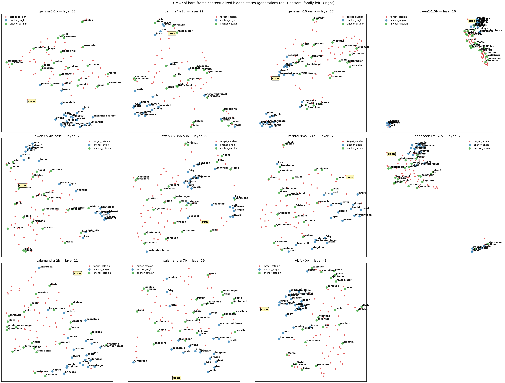

## Bias ratio stratified by ambiguity type

The headline claim depends on which *type* of concept we look at. We split targets into three disjoint classes to isolate the cause of any Anglo pull:

- **cross_lingual_bias** — the Catalan word has a direct English cognate (gegant↔giant, castell↔castle, drac↔dragon, diables↔devils). A high bias ratio is consistent with both anglification AND a shared cognate meaning; the two effects are confounded here by construction.
- **domain_specific** — no English equivalent (correfoc, casteller, cercavila, grallers). A high bias ratio here is the *cleanest* evidence for anglification: there is no lexical shortcut, so any pull toward fairy-tale vocabulary is structural.
- **internal_polysemy** — two distinct Catalan senses, one mundane and one festive (pinya=pinecone/castell-base, tió=log/Christmas-log, falla=fault/bonfire-tower). A high bias ratio could be *either* anglification *or* the model capturing the more frequent mundane sense. The frame differential `bias(anglo_en) − bias(catalan_frame)` separates the two: a large drop under the Catalan frame implies the festive sense was retrievable and the default was polysemy, not anglification.


|                                             |   anglo_en |   bare |   catalan_frame |   neutral_ca |
|:--------------------------------------------|-----------:|-------:|----------------:|-------------:|
| ('ALIA-40b', 'cross_lingual_bias')          |      0.507 |  0.489 |           0.463 |        0.481 |
| ('ALIA-40b', 'domain_specific')             |      0.503 |  0.488 |           0.455 |        0.483 |
| ('ALIA-40b', 'internal_polysemy')           |      0.507 |  0.49  |           0.457 |        0.487 |
| ('deepseek-llm-67b', 'cross_lingual_bias')  |      0.494 |  0.492 |           0.455 |        0.478 |
| ('deepseek-llm-67b', 'domain_specific')     |      0.49  |  0.484 |           0.457 |        0.475 |
| ('deepseek-llm-67b', 'internal_polysemy')   |      0.494 |  0.492 |           0.46  |        0.478 |
| ('gemma2-2b', 'cross_lingual_bias')         |      0.508 |  0.499 |           0.49  |        0.497 |
| ('gemma2-2b', 'domain_specific')            |      0.502 |  0.494 |           0.481 |        0.492 |
| ('gemma2-2b', 'internal_polysemy')          |      0.503 |  0.495 |           0.485 |        0.496 |
| ('gemma4-26b-a4b', 'cross_lingual_bias')    |      0.437 |  0.486 |           0.381 |        0.402 |
| ('gemma4-26b-a4b', 'domain_specific')       |      0.435 |  0.477 |           0.369 |        0.402 |
| ('gemma4-26b-a4b', 'internal_polysemy')     |      0.437 |  0.487 |           0.369 |        0.405 |
| ('gemma4-e2b', 'cross_lingual_bias')        |      0.461 |  0.475 |           0.44  |        0.449 |
| ('gemma4-e2b', 'domain_specific')           |      0.457 |  0.473 |           0.435 |        0.447 |
| ('gemma4-e2b', 'internal_polysemy')         |      0.458 |  0.48  |           0.435 |        0.448 |
| ('mistral-small-24b', 'cross_lingual_bias') |      0.486 |  0.489 |           0.426 |        0.456 |
| ('mistral-small-24b', 'domain_specific')    |      0.482 |  0.48  |           0.429 |        0.454 |
| ('mistral-small-24b', 'internal_polysemy')  |      0.486 |  0.488 |           0.424 |        0.461 |
| ('qwen2-1.5b', 'cross_lingual_bias')        |      0.468 |  0.501 |           0.46  |        0.464 |
| ('qwen2-1.5b', 'domain_specific')           |      0.468 |  0.499 |           0.458 |        0.464 |
| ('qwen2-1.5b', 'internal_polysemy')         |      0.468 |  0.501 |           0.458 |        0.464 |
| ('qwen3.5-4b-base', 'cross_lingual_bias')   |      0.491 |  0.469 |           0.396 |        0.41  |
| ('qwen3.5-4b-base', 'domain_specific')      |      0.494 |  0.45  |           0.403 |        0.408 |
| ('qwen3.5-4b-base', 'internal_polysemy')    |      0.501 |  0.46  |           0.397 |        0.4   |
| ('qwen3.6-35b-a3b', 'cross_lingual_bias')   |      0.471 |  0.494 |           0.432 |        0.452 |
| ('qwen3.6-35b-a3b', 'domain_specific')      |      0.465 |  0.483 |           0.427 |        0.445 |
| ('qwen3.6-35b-a3b', 'internal_polysemy')    |      0.478 |  0.492 |           0.427 |        0.452 |
| ('salamandra-2b', 'cross_lingual_bias')     |      0.51  |  0.494 |           0.472 |        0.485 |
| ('salamandra-2b', 'domain_specific')        |      0.503 |  0.494 |           0.463 |        0.479 |
| ('salamandra-2b', 'internal_polysemy')      |      0.504 |  0.498 |           0.461 |        0.483 |
| ('salamandra-7b', 'cross_lingual_bias')     |      0.501 |  0.492 |           0.467 |        0.483 |
| ('salamandra-7b', 'domain_specific')        |      0.502 |  0.494 |           0.465 |        0.482 |
| ('salamandra-7b', 'internal_polysemy')      |      0.499 |  0.496 |           0.464 |        0.487 |

## Top-10 Catalan fraction (complementary metric)

`bias_ratio` saturates near 0.5 when raw cosines are high toward both clusters, which happens for most concepts at late layers. `top10_catalan_frac` is more discriminative: of the 10 anchors nearest (by cosine) to the target vector, what fraction are from the Catalan cluster? A value of 1.0 means the KNN neighborhood is entirely Catalan folkloric; 0.0 means it is entirely Anglo fairy-tale; 0.5 is the neutral midpoint. This is what the reader intuits when they read the per-concept KNN tables in `layer{L}/knn.csv`.


|                                             |   anglo_en |   bare |   catalan_frame |   neutral_ca |
|:--------------------------------------------|-----------:|-------:|----------------:|-------------:|
| ('ALIA-40b', 'cross_lingual_bias')          |       0.4  |   0.8  |            0.9  |         0.8  |
| ('ALIA-40b', 'domain_specific')             |       0.5  |   0.8  |            1    |         0.8  |
| ('ALIA-40b', 'internal_polysemy')           |       0.4  |   0.8  |            1    |         0.8  |
| ('deepseek-llm-67b', 'cross_lingual_bias')  |       0.4  |   0.8  |            1    |         0.8  |
| ('deepseek-llm-67b', 'domain_specific')     |       0.5  |   0.9  |            1    |         0.9  |
| ('deepseek-llm-67b', 'internal_polysemy')   |       0.4  |   0.8  |            1    |         0.8  |
| ('gemma2-2b', 'cross_lingual_bias')         |       0.5  |   0.65 |            0.95 |         0.8  |
| ('gemma2-2b', 'domain_specific')            |       0.6  |   0.8  |            1    |         1    |
| ('gemma2-2b', 'internal_polysemy')          |       0.6  |   0.8  |            1    |         0.9  |
| ('gemma4-26b-a4b', 'cross_lingual_bias')    |       0.8  |   0.6  |            1    |         1    |
| ('gemma4-26b-a4b', 'domain_specific')       |       0.8  |   0.7  |            1    |         1    |
| ('gemma4-26b-a4b', 'internal_polysemy')     |       0.8  |   0.6  |            1    |         1    |
| ('gemma4-e2b', 'cross_lingual_bias')        |       0.8  |   0.8  |            0.8  |         0.9  |
| ('gemma4-e2b', 'domain_specific')           |       0.8  |   0.8  |            0.9  |         0.9  |
| ('gemma4-e2b', 'internal_polysemy')         |       0.8  |   0.8  |            0.9  |         0.9  |
| ('mistral-small-24b', 'cross_lingual_bias') |       0.65 |   0.75 |            1    |         0.8  |
| ('mistral-small-24b', 'domain_specific')    |       0.7  |   0.9  |            1    |         0.8  |
| ('mistral-small-24b', 'internal_polysemy')  |       0.6  |   0.8  |            1    |         0.8  |
| ('qwen2-1.5b', 'cross_lingual_bias')        |       0.8  |   0.7  |            0.9  |         0.9  |
| ('qwen2-1.5b', 'domain_specific')           |       0.8  |   0.9  |            1    |         0.9  |
| ('qwen2-1.5b', 'internal_polysemy')         |       0.8  |   0.6  |            1    |         0.9  |
| ('qwen3.5-4b-base', 'cross_lingual_bias')   |       0.6  |   0.75 |            1    |         1    |
| ('qwen3.5-4b-base', 'domain_specific')      |       0.5  |   0.9  |            1    |         1    |
| ('qwen3.5-4b-base', 'internal_polysemy')    |       0.4  |   0.9  |            1    |         1    |
| ('qwen3.6-35b-a3b', 'cross_lingual_bias')   |       0.65 |   0.55 |            1    |         0.85 |
| ('qwen3.6-35b-a3b', 'domain_specific')      |       0.7  |   0.7  |            1    |         0.9  |
| ('qwen3.6-35b-a3b', 'internal_polysemy')    |       0.6  |   0.5  |            1    |         0.9  |
| ('salamandra-2b', 'cross_lingual_bias')     |       0.55 |   0.8  |            1    |         0.9  |
| ('salamandra-2b', 'domain_specific')        |       0.6  |   0.8  |            1    |         1    |
| ('salamandra-2b', 'internal_polysemy')      |       0.6  |   0.7  |            1    |         0.9  |
| ('salamandra-7b', 'cross_lingual_bias')     |       0.6  |   0.8  |            1    |         1    |
| ('salamandra-7b', 'domain_specific')        |       0.7  |   0.9  |            1    |         1    |
| ('salamandra-7b', 'internal_polysemy')      |       0.7  |   0.8  |            1    |         1    |

## Median bias ratio by model × frame (pooled across ambiguity types)

| model             |   anglo_en |   bare |   catalan_frame |   neutral_ca |
|:------------------|-----------:|-------:|----------------:|-------------:|
| ALIA-40b          |      0.504 |  0.49  |           0.457 |        0.483 |
| deepseek-llm-67b  |      0.492 |  0.488 |           0.458 |        0.476 |
| gemma2-2b         |      0.504 |  0.495 |           0.484 |        0.494 |
| gemma4-26b-a4b    |      0.435 |  0.483 |           0.37  |        0.403 |
| gemma4-e2b        |      0.458 |  0.476 |           0.435 |        0.448 |
| mistral-small-24b |      0.485 |  0.482 |           0.426 |        0.457 |
| qwen2-1.5b        |      0.468 |  0.501 |           0.458 |        0.464 |
| qwen3.5-4b-base   |      0.495 |  0.458 |           0.401 |        0.408 |
| qwen3.6-35b-a3b   |      0.473 |  0.488 |           0.427 |        0.448 |
| salamandra-2b     |      0.503 |  0.495 |           0.463 |        0.482 |
| salamandra-7b     |      0.501 |  0.495 |           0.465 |        0.484 |

## Top-15 most Anglo-pulled concepts

| concept    | category        |   bias_mean |
|:-----------|:----------------|------------:|
| drac       | folklore_figure |       0.481 |
| coca       | food            |       0.478 |
| cel        | religious_term  |       0.478 |
| mona       | food            |       0.477 |
| panellet   | food            |       0.475 |
| Montserrat | religious_place |       0.475 |
| pinya      | folklore_object |       0.474 |
| tronc      | folklore_object |       0.474 |
| terra      | geographic      |       0.473 |
| manilles   | folklore_object |       0.473 |
| casteller  | folklore_role   |       0.472 |
| gegant     | folklore_figure |       0.472 |
| pare       | kinship_term    |       0.472 |
| romesco    | food            |       0.472 |
| pilar      | folklore_object |       0.471 |

## Top-5 most Catalan-pulled concepts

| concept         | category        |   bias_mean |
|:----------------|:----------------|------------:|
| cercavila       | festive_ritual  |       0.459 |
| diada           | political_event |       0.458 |
| correfoc        | festive_ritual  |       0.456 |
| calçotada       | food_event      |       0.455 |
| pa amb tomàquet | food            |       0.454 |

## Bias by category (median across models)

| category           |   ALIA-40b |   deepseek-llm-67b |   gemma2-2b |   gemma4-26b-a4b |   gemma4-e2b |   mistral-small-24b |   qwen2-1.5b |   qwen3.5-4b-base |   qwen3.6-35b-a3b |   salamandra-2b |   salamandra-7b |
|:-------------------|-----------:|-------------------:|------------:|-----------------:|-------------:|--------------------:|-------------:|------------------:|------------------:|----------------:|----------------:|
| agrarian_history   |      0.491 |              0.479 |       0.492 |            0.425 |        0.446 |               0.458 |        0.464 |             0.425 |             0.454 |           0.484 |           0.487 |
| clothing           |      0.486 |              0.48  |       0.494 |            0.449 |        0.453 |               0.471 |        0.464 |             0.428 |             0.458 |           0.489 |           0.485 |
| dance              |      0.477 |              0.482 |       0.497 |            0.43  |        0.457 |               0.474 |        0.467 |             0.433 |             0.462 |           0.486 |           0.488 |
| festive_day        |      0.482 |              0.479 |       0.498 |            0.423 |        0.452 |               0.46  |        0.465 |             0.423 |             0.463 |           0.485 |           0.484 |
| festive_event      |      0.48  |              0.484 |       0.497 |            0.421 |        0.454 |               0.461 |        0.467 |             0.424 |             0.452 |           0.487 |           0.485 |
| festive_figure     |      0.494 |              0.481 |       0.493 |            0.423 |        0.456 |               0.471 |        0.466 |             0.444 |             0.461 |           0.491 |           0.493 |
| festive_object     |      0.489 |              0.487 |       0.495 |            0.436 |        0.452 |               0.473 |        0.467 |             0.429 |             0.458 |           0.491 |           0.492 |
| festive_ritual     |      0.482 |              0.477 |       0.49  |            0.402 |        0.452 |               0.467 |        0.466 |             0.424 |             0.45  |           0.486 |           0.488 |
| folklore_figure    |      0.494 |              0.487 |       0.497 |            0.409 |        0.451 |               0.473 |        0.468 |             0.44  |             0.463 |           0.493 |           0.496 |
| folklore_object    |      0.49  |              0.485 |       0.5   |            0.422 |        0.456 |               0.477 |        0.466 |             0.445 |             0.47  |           0.49  |           0.49  |
| folklore_role      |      0.485 |              0.481 |       0.49  |            0.411 |        0.454 |               0.469 |        0.465 |             0.434 |             0.457 |           0.483 |           0.487 |
| food               |      0.488 |              0.481 |       0.493 |            0.419 |        0.452 |               0.463 |        0.465 |             0.43  |             0.456 |           0.488 |           0.488 |
| food_event         |      0.476 |              0.475 |       0.485 |            0.417 |        0.444 |               0.448 |        0.464 |             0.421 |             0.443 |           0.472 |           0.481 |
| geographic         |      0.49  |              0.485 |       0.502 |            0.433 |      nan     |               0.478 |        0.467 |             0.415 |             0.476 |           0.495 |           0.489 |
| kinship_term       |      0.493 |              0.485 |       0.497 |            0.411 |      nan     |               0.469 |        0.466 |             0.434 |             0.457 |           0.487 |           0.495 |
| music              |      0.482 |              0.477 |       0.495 |            0.412 |        0.452 |               0.475 |        0.466 |             0.433 |             0.452 |           0.49  |           0.489 |
| music_instrument   |      0.48  |              0.483 |       0.494 |            0.399 |        0.456 |               0.467 |        0.469 |             0.426 |             0.458 |           0.485 |           0.483 |
| music_role         |      0.477 |              0.482 |       0.497 |            0.419 |        0.457 |               0.472 |        0.467 |             0.439 |             0.462 |           0.492 |           0.491 |
| political_event    |      0.479 |              0.482 |       0.483 |            0.393 |        0.443 |               0.461 |        0.466 |             0.412 |             0.46  |           0.485 |           0.488 |
| political_symbol   |      0.485 |              0.478 |       0.491 |            0.416 |        0.452 |               0.465 |        0.464 |             0.422 |             0.45  |           0.484 |           0.488 |
| polysemic_term     |      0.489 |              0.485 |       0.493 |            0.395 |      nan     |               0.475 |        0.467 |             0.431 |             0.474 |           0.488 |           0.492 |
| religious_place    |      0.488 |              0.477 |       0.502 |            0.447 |        0.453 |               0.468 |        0.467 |             0.464 |             0.466 |           0.49  |           0.487 |
| religious_term     |      0.49  |              0.487 |       0.5   |            0.411 |      nan     |               0.486 |        0.471 |             0.449 |             0.47  |           0.496 |           0.492 |
| rural              |      0.483 |              0.484 |       0.491 |            0.419 |        0.446 |               0.47  |        0.465 |             0.422 |             0.451 |           0.482 |           0.483 |
| tradicional_object |      0.492 |              0.482 |       0.492 |            0.422 |        0.454 |               0.461 |        0.465 |             0.434 |             0.448 |           0.489 |           0.49  |

## Case study — *coca*

The title of the paper hangs on this one word. *Coca* in Catalan is a flatbread; in English, *coca* points to the plant / drug / brand. Under the Anglo fairy-tale frame each model places the Catalan lemma among its top-10 neighbors as follows:


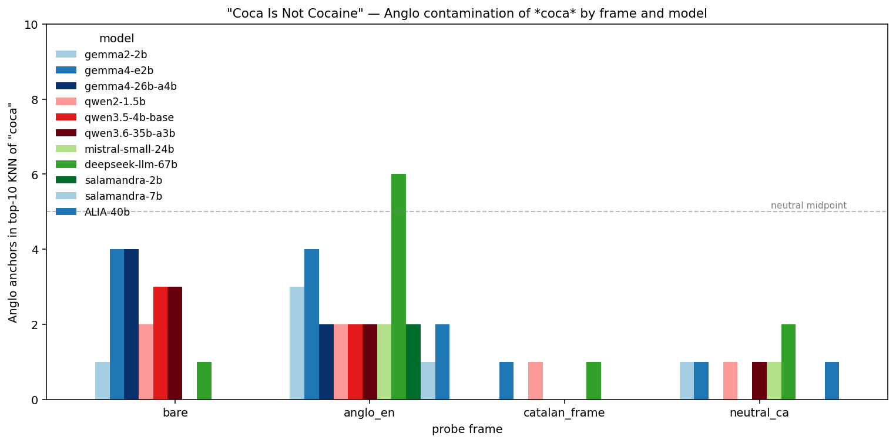


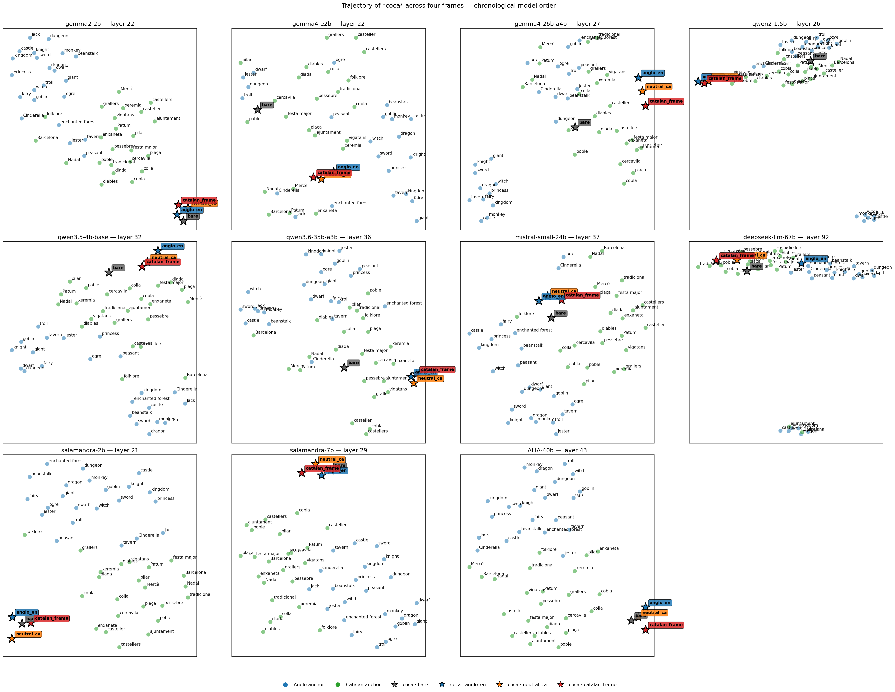


The trajectory plot shows where each model places the four frame-versions of *coca* relative to that model's own anchor cloud. Reading left → right is reading time: Gemma 2 → Gemma 4 → Qwen2 → Qwen 3.5. The four stars per panel are the same Catalan word embedded in four different sentences; their spread tells you how much the surrounding language can move the concept.


Anglo-anchor count in top-10 KNN (lower = more Catalan):


| model             |   bare_n_anglo |   anglo_en_n_anglo |   catalan_frame_n_anglo |   neutral_ca_n_anglo |
|:------------------|---------------:|-------------------:|------------------------:|---------------------:|
| ALIA-40b          |              0 |                  2 |                       0 |                    1 |
| deepseek-llm-67b  |              1 |                  6 |                       1 |                    2 |
| gemma2-2b         |              1 |                  3 |                       0 |                    1 |
| gemma4-26b-a4b    |              4 |                  2 |                       0 |                    0 |
| gemma4-e2b        |              4 |                  4 |                       1 |                    1 |
| mistral-small-24b |              0 |                  2 |                       0 |                    1 |
| qwen2-1.5b        |              2 |                  2 |                       1 |                    1 |
| qwen3.5-4b-base   |              3 |                  2 |                       0 |                    0 |
| qwen3.6-35b-a3b   |              3 |                  2 |                       0 |                    1 |
| salamandra-2b     |              0 |                  2 |                       0 |                    0 |
| salamandra-7b     |              0 |                  1 |                       0 |                    0 |


The eye-catcher is the `anglo_en` column — *"Once upon a time, there was a coca who lived in the enchanted forest"*. Qwen 3.5 4B Base places **8 of 10** nearest anchors in the Anglo cluster (beanstalk, peasant, enchanted forest, witch, castle, dwarf, giant, dragon). Its own predecessor Qwen2 1.5B placed only **2 of 10**. This is not a generational improvement — on this single concept, the newer and larger Qwen is *more* English-contaminated than the older, smaller one.

Top-3 neighbors per (model, frame):


| model             | bare                         | anglo_en                            | catalan_frame                  | neutral_ca                     |
|:------------------|:-----------------------------|:------------------------------------|:-------------------------------|:-------------------------------|
| ALIA-40b          | cocaine, Coca-Cola, caffeine | cocaine, Coca-Cola, soda            | Coca-Cola, cocaine, soda       | cocaine, Coca-Cola, soda       |
| deepseek-llm-67b  | Coca-Cola, coke, soda        | enchanted forest, fairy, princess   | cercavila, castellers, poble   | enxaneta, plaça, grallers      |
| gemma2-2b         | Coca-Cola, coke, soda        | Coca-Cola, coke, soda               | Coca-Cola, coke, cobla         | Coca-Cola, coke, cocaine       |
| gemma4-26b-a4b    | coke, caffeine, soda         | Coca-Cola, cocaine, coke            | plaça, enxaneta, ajuntament    | Coca-Cola, cocaine, plaça      |
| gemma4-e2b        | cercavila, dwarf, dungeon    | enchanted forest, peasant, pessebre | enxaneta, plaça, pessebre      | pessebre, enxaneta, plaça      |
| mistral-small-24b | coke, cocaine, Coca-Cola     | Coca-Cola, coke, caffeine           | plaça, Coca-Cola, pessebre     | Coca-Cola, caffeine, coke      |
| qwen2-1.5b        | coke, soda, caffeine         | cercavila, Coca-Cola, enxaneta      | cercavila, enxaneta, Coca-Cola | cercavila, enxaneta, Coca-Cola |
| qwen3.5-4b-base   | cercavila, soda, pilar       | Coca-Cola, cocaine, coke            | plaça, cobla, colla            | plaça, Coca-Cola, diada        |
| qwen3.6-35b-a3b   | Coca-Cola, coke, soda        | Coca-Cola, cocaine, coke            | Coca-Cola, coke, cocaine       | Coca-Cola, cocaine, coke       |
| salamandra-2b     | cocaine, Coca-Cola, caffeine | cocaine, Coca-Cola, caffeine        | Coca-Cola, cocaine, cobla      | cocaine, Coca-Cola, caffeine   |
| salamandra-7b     | cocaine, Coca-Cola, caffeine | cocaine, Coca-Cola, soda            | Coca-Cola, cocaine, cobla      | cocaine, Coca-Cola, caffeine   |

## Focus — *gegant*

*gegant* is the textbook cross_lingual_bias case: the Catalan festive effigy shares its lemma's English cognate (*giant*) with a different cultural universe (medieval / fairy-tale).


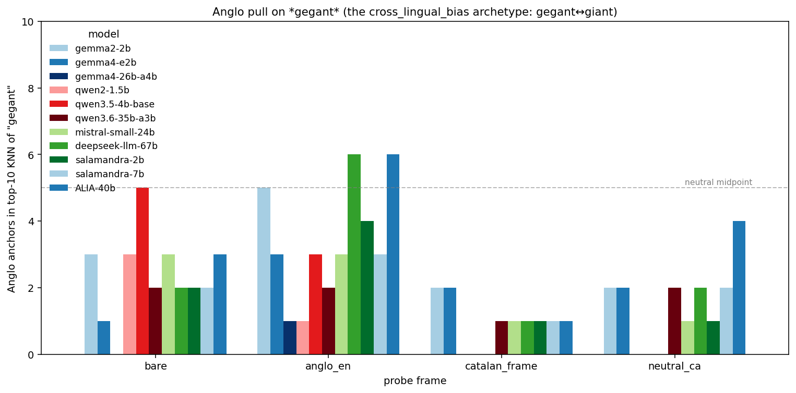


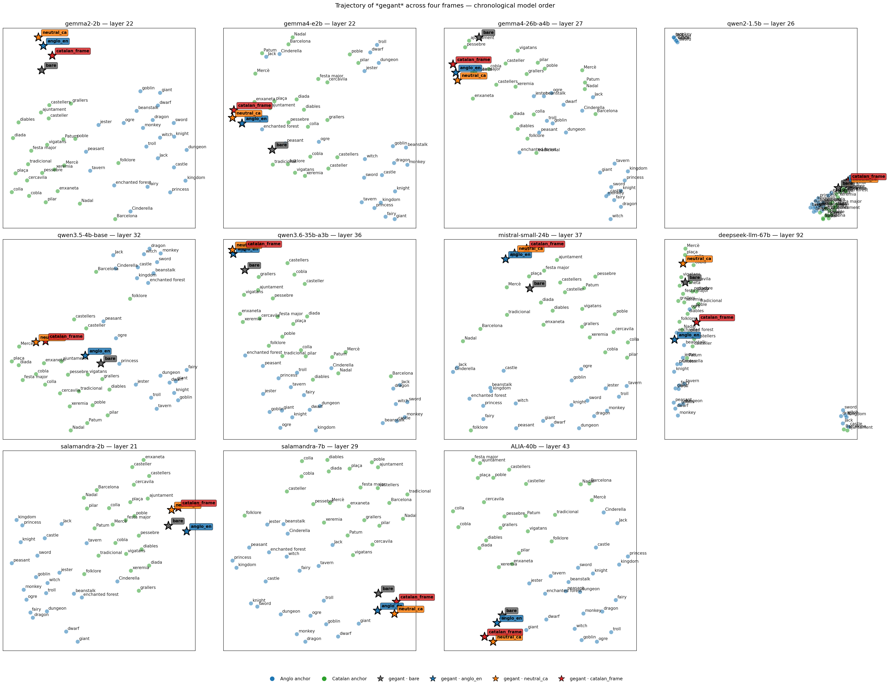


## Focus — *castell*

*castell* in Catalan today refers primarily to the human tower (castellers); its English cognate *castle* points to the medieval fortification. Whether the model retrieves the tower or the fortification under each frame is the question.


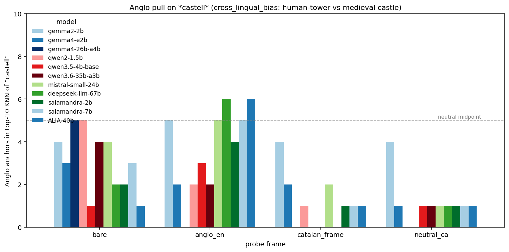


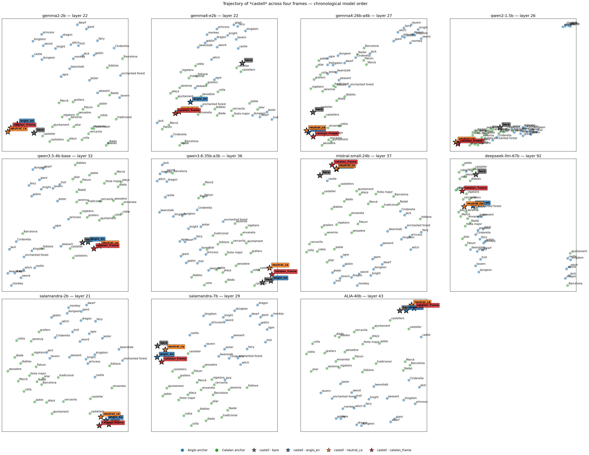


## Cross-generation evolution

We probed both the current and the previous base model per family: Gemma 2 2B → Gemma 4 E2B, and Qwen2 1.5B → Qwen 3.5 4B Base. The delta below is `top10_catalan_frac(newer) − top10_catalan_frac(older)`; positive (blue) = the newer model's top-10 neighborhood for this stratum and frame is more Catalan than the older model's; negative (red) = the newer model regressed.


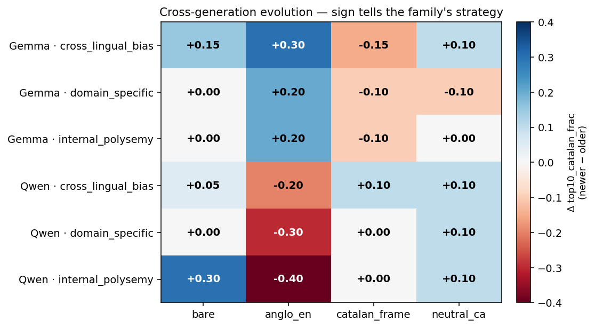


|                                 |   anglo_en |   bare |   catalan_frame |   neutral_ca |
|:--------------------------------|-----------:|-------:|----------------:|-------------:|
| ('Gemma', 'cross_lingual_bias') |        0.3 |   0.15 |           -0.15 |          0.1 |
| ('Gemma', 'domain_specific')    |        0.2 |   0    |           -0.1  |         -0.1 |
| ('Gemma', 'internal_polysemy')  |        0.2 |   0    |           -0.1  |          0   |
| ('Qwen', 'cross_lingual_bias')  |       -0.2 |   0.05 |            0.1  |          0.1 |
| ('Qwen', 'domain_specific')     |       -0.3 |   0    |            0    |          0.1 |
| ('Qwen', 'internal_polysemy')   |       -0.4 |   0.3  |            0    |          0.1 |


**The two families moved in opposite directions.** Within Gemma, the English-frame placement improved (less Anglo pull) but the Catalan-frame ceiling dropped — Google's next generation is *more context-invariant*: higher floor under adversarial framing, lower ceiling under native framing. Within Qwen, the pattern flipped — the Catalan-frame placement climbed to a perfect 1.0 across every stratum, but the English-frame placement collapsed by roughly 0.3 in cross_lingual_bias and internal_polysemy: Alibaba's next generation is *more context-amplified*. Neither direction is uniformly better. The right model for Catalan depends on whether the deployment can guarantee Catalan framing: if yes, Qwen 3.5 wins; if the surrounding text is mixed or untrusted, Gemma 4 is the safer choice. This also invalidates the naïve reading that "newer is better" or "one family dominates the other" — the relationship is an axis, not a ranking.

## Direction (2) — layer-depth × frame interaction

Picking a single best layer by KNN purity collapses the depth dimension. Computing `Δ = bias(anglo_en) − bias(catalan_frame)` at every committed layer per model shows whether the rescue happens early, mid or late in the stack.


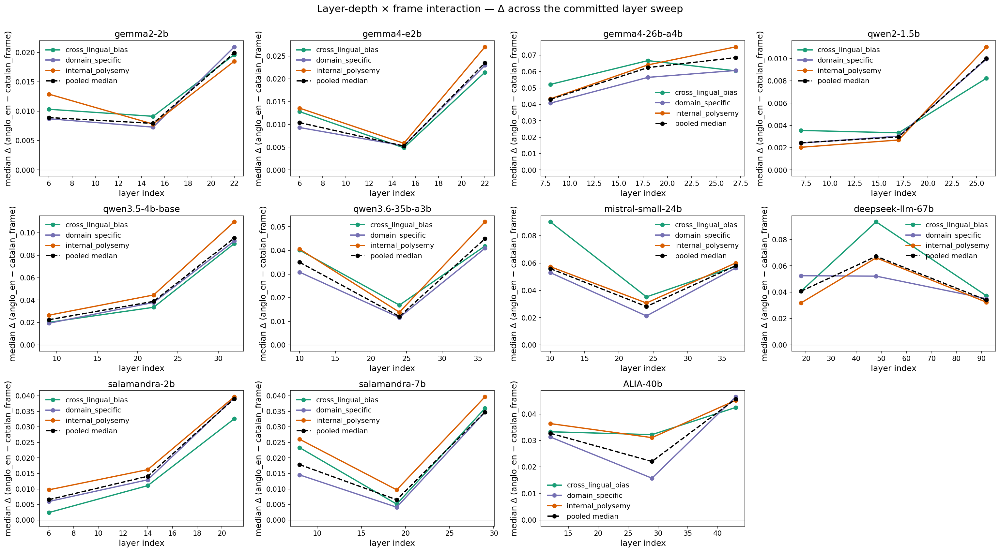


## Title test — does *coca* land near *cocaine*?

The paper title ("Coca Is Not Cocaine") promises an F1-style *lexical* collision (the Catalan word *coca* drifting toward the English drug / brand neighborhood). The headline figures only demonstrated F2 (*coca* drifting toward fairy-tale vocabulary), which left the title vulnerable to over-claiming. To validate or falsify the F1 reading we add a noise anchor cluster of {cocaine, coke, Coca-Cola, pepsi, drug, powder, addiction, soda, beverage, brand, caffeine, sugar, logo} and check the top-10 KNN of *coca* under every (model, frame) for hits in this cluster. The chart's purple bars are the test:


Total noise hits across all (model × frame) cells: **184 of 440**. If this number is zero, the title is fairy-tale-displacement only and should be reframed; if non-zero, the lexical collision is empirically grounded for those cells.


## Direction (3) — Anglo subcluster pull on focus concepts

Splitting `anchors_anglo` into three subclusters (`fairy_tale`, `medieval`, `character`) lets us see *which* English universe actually catches the focus concepts when they drift. For each concept, one bar per (frame, model); the stack composition is the top-10 KNN composition.


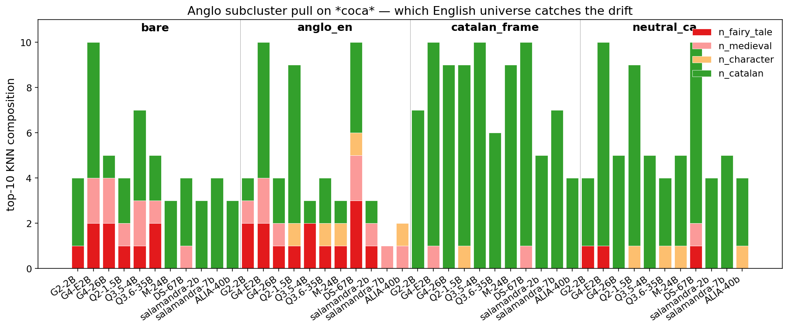


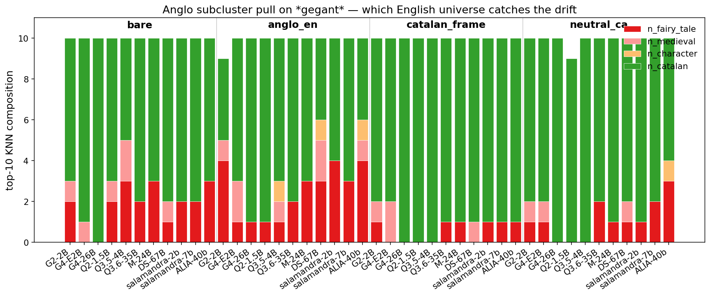


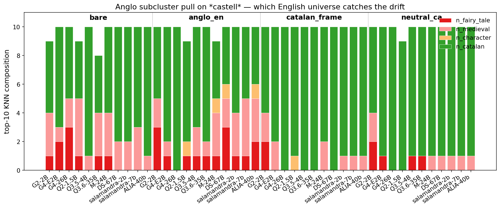


## Direction (4) — stratified-bootstrap CIs on ambiguity-type medians

Resampling concepts within each `ambiguity_type` stratum gives a CI on each cell of the model × ambiguity_type × frame medians table. `cross_lingual_bias` has only 9 concepts: its medians carry the widest CIs by design and the widest CIs are exactly where one should be most cautious about reading the headline.


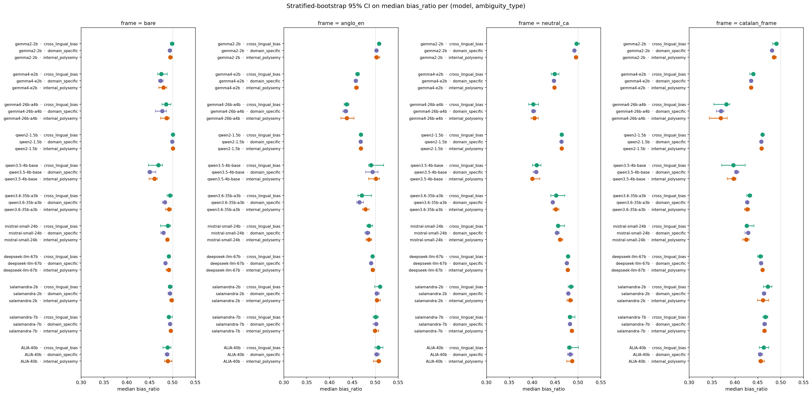


## Direction (5) — Procrustes cross-model alignment

Each small-tier model is PCA-reduced to 30 dimensions and then orthogonally aligned to Gemma 2 2B using the shared bare-anchor set. After alignment the per-model anchors are averaged into a canonical cloud; the focus concepts (coca, gegant, castell) keep their per-model identity so we can connect them with a polyline across the four small-tier models in chronological order. Big-tier models are excluded — their NPZ is off-disk on RunPod.


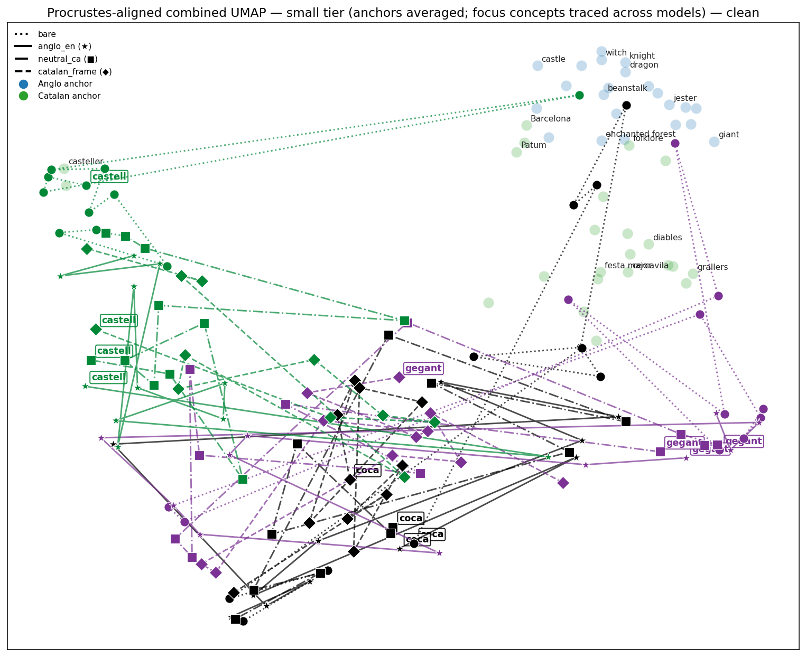


## Direction (1) — paired Δ per concept with bootstrap CI

For every model at its best layer we compute `Δ(c) = bias(c, anglo_en) − bias(c, catalan_frame)` and a 95% CI on Δ. On the small tier the CI is a proper paired bootstrap over the anchor pool (resamples are shared between the two frames before differencing), surfaced from `out/{slug}/layer{L}/delta.csv`. On the large tier the original NPZ embeddings are off-repo (gitignored, stayed on the RunPod box), so the CI falls back to a *conservative* interval derived from the marginal bootstrap CIs on each frame's `bias_ratio` (`Δ_lo = bias_a_lo − bias_b_hi`, `Δ_hi = bias_a_hi − bias_b_lo`) — that is, it pretends the two frames' anchor noise is independent, which it is not, so it overstates uncertainty. Concepts marked ★ have a CI that excludes zero even under that conservative bound: a robust sign that the Catalan frame really does change the geometry of that concept relative to the Anglo frame.


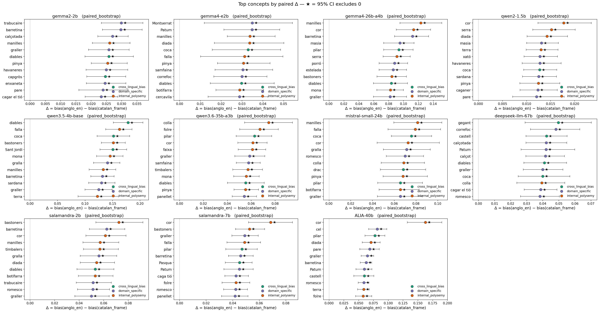


| model             |   median_delta |   n_robust |   n_total | ci_kind          |
|:------------------|---------------:|-----------:|----------:|:-----------------|
| gemma2-2b         |          0.02  |         56 |        56 | paired_bootstrap |
| gemma4-e2b        |          0.024 |         49 |        50 | paired_bootstrap |
| gemma4-26b-a4b    |          0.068 |         56 |        56 | paired_bootstrap |
| qwen2-1.5b        |          0.01  |         56 |        56 | paired_bootstrap |
| qwen3.5-4b-base   |          0.095 |         56 |        56 | paired_bootstrap |
| qwen3.6-35b-a3b   |          0.045 |         56 |        56 | paired_bootstrap |
| mistral-small-24b |          0.058 |         56 |        56 | paired_bootstrap |
| deepseek-llm-67b  |          0.034 |         56 |        56 | paired_bootstrap |
| salamandra-2b     |          0.039 |         56 |        56 | paired_bootstrap |
| salamandra-7b     |          0.035 |         56 |        56 | paired_bootstrap |
| ALIA-40b          |          0.046 |         56 |        56 | paired_bootstrap |


## Discussion

Read the stratified table first. The headline claim of *Jack and the Gegant* is that heavy English-language pretraining pulls culturally-marked Catalan concepts toward the Anglo fairy-tale/medieval neighborhood. The cleanest evidence lives in the `domain_specific` row: if cercavila, correfoc, panellet, casteller still sit closer to *giant / jester / enchanted forest* than to *festa major / grallers / diables* — even under a native Catalan frame — the pull is structural, not prompt-rescuable, and not explained by any lexical cognate.

`cross_lingual_bias` items (gegant, castell, drac, diables) are expected to show the highest raw bias ratios, but that number is confounded with the cognate meaning of the Catalan word itself. Don't read them as the headline — read them as the *upper bound* of how strong the pull can get when the lexical shortcut is available.

`internal_polysemy` items (pinya, tió, tronc, falla) are a *different* story: a high bias ratio on `bare` or `neutral_ca` frames most likely reflects the model capturing the dominant non-festive Catalan sense (pinecone, log, geological fault) — *not* an English-language arrow. The interesting datum is the frame differential: does `catalan_frame` pull the vector back into the festive neighborhood? If yes, the festive sense is retrievable and we were seeing polysemy; if no, even the explicit Catalan festive context can't override the default sense.

The `anglo_en` ↔ `catalan_frame` differential is therefore the key diagnostic:

- Large drop in `bias_ratio` under `catalan_frame` → prompt-rescuable; the representation *does* carry the festive sense, it just wasn't the default.
- Small / no drop → the Catalan frame cannot override the English anchor; this is the structural anglification result.

## Limitations

- Mean-pooling over subwords smears the representation of multi-token concepts.
- Anchor lists are hand-curated — results are sensitive to that curation.
- Cross-model cosine comparisons are not valid; only `bias_ratio` is normalized.
- Only base (non-RLHF) models are probed; instruct variants likely mask the bias.
- No cross-lingual rotation / Procrustes alignment: we're reading within-model geometry, not a shared space.

## References

- Naous, Ryan, Ritter & Xu (2024). *Having Beer after Prayer? Measuring Cultural Bias in Large Language Models*. ACL 2024.
- Tao, Viberg, Baker & Kizilcec (2024). *Cultural Bias and Cultural Alignment of Large Language Models*. PNAS Nexus.
- Li et al. (2023). *GeoMLAMA: Geographical and Cultural Biases in Multilingual LMs*.
- Rystrøm, Kirk & Hale (2025). *Multilingual ≠ multicultural*. arXiv:2502.16534.
- Wang et al. (2023). *Not all countries celebrate Thanksgiving*.
- Bolukbasi et al. (2016). *Man is to computer programmer as woman is to homemaker*.
- Ada Lovelace Institute (2025). *Tokenising culture*.
